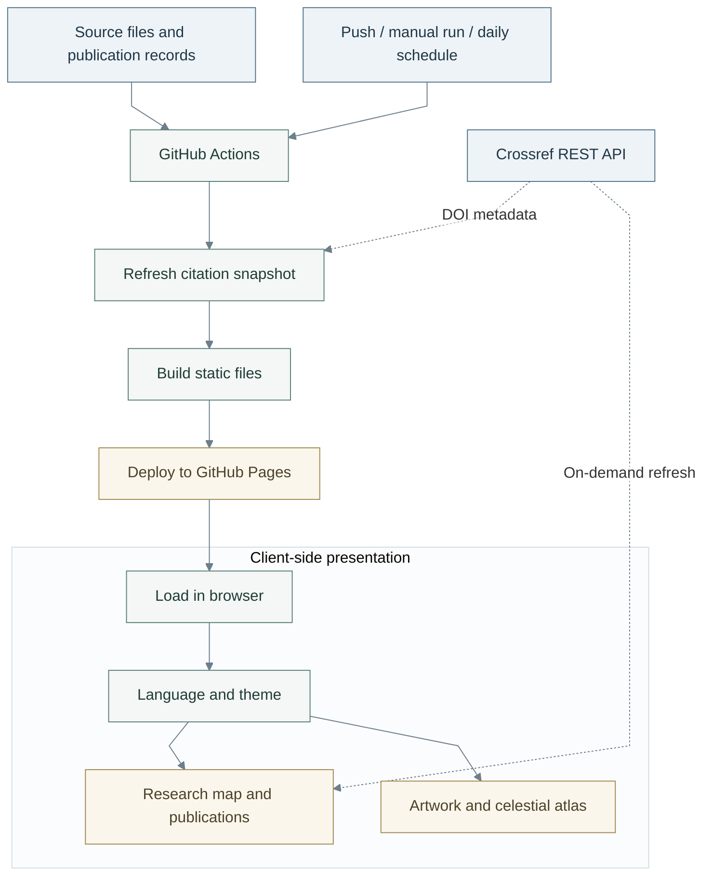

# Interactive Academic Portfolio

A static, bilingual interface for research presentation, publication discovery and scientific visualization.

## System parameters

| Parameter | Specification |
| :--- | :--- |
| Release | **V1** (`1.0.0`) |
| Architecture | Static files; browser-side interaction; no runtime application server |
| Front end | HTML5, CSS3 and JavaScript |
| Visualization | Canvas 2D, SVG, Three.js / WebGL; Astronomy Engine |
| Language | English by default; Chinese selectable |
| Layout | Responsive phone, tablet and desktop layouts; five palettes |
| Citation data | DOI-linked Crossref Cited-by; local snapshot and browser refresh |
| Build environment | Node.js ≥ 18; Node.js 24 in the supplied workflow; no npm dependencies to install |
| Deployment | GitHub Pages; static output in `dist/` |

## System workflow



**Figure 1.** Build and runtime data flow. Solid arrows denote processing or navigation; dashed arrows denote external data retrieval. Failed citation requests retain the last verified values.

## Local execution

Open `index.html` directly, or use Node.js for HTTP preview and deployment output:

```sh
npm run dev      # start local preview
npm run build    # write dist/
npm run preview  # serve dist/
```

## Code organization

```text
index.html                 Homepage structure
assets/site.css            Consolidated homepage styles
assets/site.js             Consolidated homepage interactions
assets/startup.js          First-paint and page-entry coordination
assets/resume.html         Academic profile structure
assets/resume.css          Academic profile styles
assets/resume.js           Academic profile behaviour
assets/publications.js     Editable publication records
assets/citations-data.js   Refreshable citation snapshot
assets/fonts/              Local fonts and license notices
assets/vendor/             Third-party libraries and notices
scripts/                   Citation maintenance
.github/workflows/         Deployment automation
```

The main styles and application logic are organized into named sections. Fonts, artwork, scientific datasets and vendor libraries remain separate resources. No frontend bundler or package installation is required.

## Configuration

| Purpose | Entry point |
| :--- | :--- |
| Page structure and bilingual copy | `index.html`; Language and homepage copy in `assets/site.js` |
| Publication records and research mapping | `assets/publications.js`; Research-map navigation in `assets/site.js` |
| Visual themes and typography | `assets/site.css`; Theme selection in `assets/site.js` |
| Academic profile | `assets/resume.html`, `assets/resume.js` |
| Citation refresh and deployment | `scripts/update-citations.mjs`, `.github/workflows/citations.yml` |

For GitHub Pages, retain the directory structure and select **Settings → Pages → Source → GitHub Actions**. The workflow runs on `main` pushes, manual dispatch and a daily 07:23 UTC schedule. Set the project release in `package.json` and this table together.

## Data provenance

Citation counts come from Crossref and may differ from Google Scholar; zero and unavailable counts are hidden. Visual motifs are conceptual illustrations. Stellar coordinates use the documented catalog and ephemeris sources.

See [citation methodology](assets/citation-notes.md), [research-map scope](assets/research-map-notes.md), [stellar data and attribution](assets/star-catalog-license.md), [artwork provenance](assets/artwork-notes.md) and [display-font license](assets/name-signature-notes.md). Third-party notices remain beside their assets in `assets/vendor/` and `assets/fonts/`.
